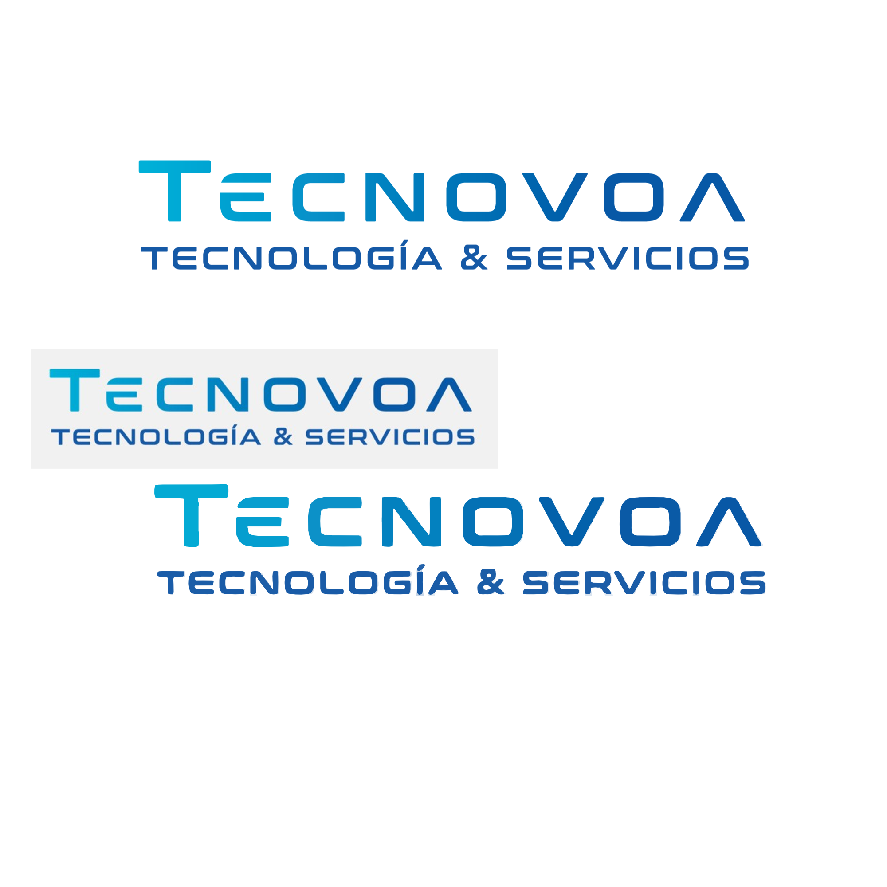
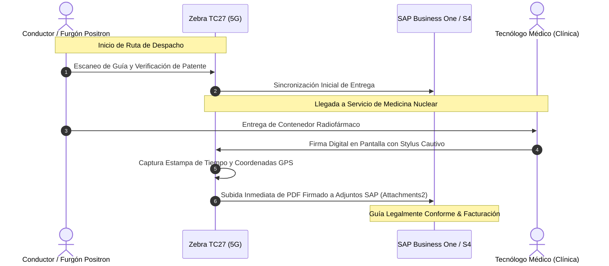

  <table border="0" style="border-collapse: collapse; border: none;">
    <tr style="border: none;">
      <td align="center" style="padding: 15px; border: none;">
        
      </td>
      <td align="center" style="padding: 15px; font-size: 24px; color: #64748b; border: none;">✕</td>
      <td align="center" style="padding: 15px; border: none;">
        
      </td>
    </tr>
  </table>

  # Renovación Integral de Parque Tecnológico & Continuidad Operativa
  ### Proyecto Corporativo en Modalidad Leasing Tecnológico (36 Meses)
  
  **Cliente:** Positronpharma S.A. &nbsp;|&nbsp; **RUT:** 76.089.296-3 &nbsp;|&nbsp; **Sector:** Salud Humana & Radiofármacos  
  **Integrador Tecnológico:** TECNOVOA SPA &nbsp;|&nbsp; **Asesor Comercial:** Cristian Díaz ([cristian@tecnovoa.cl](mailto:cristian@tecnovoa.cl))

  

    
    
    
    
  

---

## 🏛️ Alianza Estratégica & Ecosistema de Fabricantes (Vendors)

Este proyecto consolida hardware empresarial de misión crítica respaldado directamente por los principales fabricantes mundiales de tecnología con contratos de garantía oficial y soporte de fábrica en Chile (**Lenovo, Zebra Technologies, Brother y Epson**):

  <table border="0" style="border-collapse: collapse; border: none;">
    <tr style="border: none;">
      <td align="center" width="20%" style="padding: 10px; border: none;">
         
        <strong>Lenovo ThinkPad / ThinkCentre</strong> 35 Laptops Ultra + 3 AIOs + 5 Tablets
      </td>
      <td align="center" width="20%" style="padding: 10px; border: none;">
         
        <strong>Zebra Technologies</strong> 8 Handhelds TC27 5G (Despacho SAP)
      </td>
      <td align="center" width="20%" style="padding: 10px; border: none;">
         
        <strong>Brother At Your Side</strong> Multifuncional Láser Color con PIN
      </td>
      <td align="center" width="20%" style="padding: 10px; border: none;">
         
        <strong>Epson EcoTank</strong> Multifunción Tinta Pigmentada RRHH
      </td>
      <td align="center" width="20%" style="padding: 10px; border: none;">
         
        <strong>HP Enterprise</strong> Alternativa Managed / Smart Tank
      </td>
    </tr>
  </table>

---

## 🎯 Resumen Ejecutivo del Negocio

El proyecto responde a dos requerimientos estratégicos de **Positronpharma S.A.**:
1. **Renovación y Estandarización de Parque TI (53 Equipos):** Reemplazo de equipamiento heterogéneo y obsoleto por plataformas homogéneas Lenovo ThinkPad con procesadores **Intel® Core™ Ultra** con NPU para Inteligencia Artificial y garantía **Premier Support On-site de 3 Años con ADP** (protección contra derrames y caídas accidentales).
2. **Cumplimiento Normativo en Despacho de Radiofármacos (SAP):** Implementación de 8 terminales industriales **Zebra TC27 5G** con lápiz stylus cautivo para captura de firma en destino por tecnólogo médico, registro de chofer y patente del furgón, e integración automática con SAP.
3. **Optimización Financiera (OPEX 100% Gasto):** Adquisición vía Leasing Tecnológico a 36 meses financiado por DLL / CSI Leasing, eliminando desembolsos de capital (Capex) y reduciendo la carga impositiva.

---

## 📊 Matriz Consolidada de Equipamiento (53 Equipos)

| # | Línea | Cant. | P/N Oficial | Descripción Técnica | Stock Validado | Inversión Neta (CLP) | Cuota Est. 36m (Neto CLP) |
| :---: | :--- | :---: | :--- | :--- | :---: | :---: | :---: |
| **1** | **Notebook Estándar** | 29 | `21SY002QCL` | **ThinkPad E14 Gen 7:** Intel Core Ultra 5 225U, 16GB DDR5, 512GB SSD Opal 2.0, 14" WUXGA, W11P, 3Y Onsite | 216 uds | $33.350.000 | **$991.800 / mes** |
| **2** | **Notebook Rendimiento** | 6 | `21QD001GCL` | **ThinkPad T14 Gen 6:** Intel Core Ultra 7 255U, 16GB DDR5, 512GB SSD Perf., 14" WUXGA 400nits, 3Y Premier + ADP | 204 uds | $10.200.000 | **$295.200 / mes** |
| **3** | **Multifunción Láser Color** | 1 | `MFC-L3760CDW` | **Brother MFC-L3760CDW:** 28 ppm, Dúplex, Red, Impresión Segura por PIN (RRHH / Contratos) | 9 uds | $650.000 | **$19.800 / mes** |
| **4** | **Multifunción Tanque Tinta** | 1 | `C11CJ88303` | **Epson EcoTank L6490:** Tintas Pigmentadas DURABrite resistentes al agua, ADF, Dúplex, Red | 51 uds | $500.000 | **$15.200 / mes** |
| **5** | **Tablet 5G Supervisión** | 5 | `ZAFM0762CL` | **Lenovo IdeaTab 11" 2.5K 5G:** Dimensity 6300, 6GB/128GB, Teclado Folio + Pen Plus incluidos | 200+ uds | $1.750.000 | **$52.150 / mes** |
| **6** | **All in One 24" Puesto Fijo** | 3 | `13QH004HCS` | **ThinkCentre Neo 50a 24 G6:** Core Ultra 5 226V, 16GB RAM, 512GB SSD, 23.8" FHD IPS, 3Y Onsite | 292 uds | $3.600.000 | **$106.000 / mes** |
| **7** | **Handheld Industrial SAP** | 8 | `WCMTB-T27B6ABC2-A6` | **Zebra TC27 5G:** Pantalla 6" FHD+, Escáner 2D SE4710, Handstrap, Stylus Tether Metálico | >20 uds | $6.000.000 | **$182.664 / mes** |
| — | **TOTAL PARQUE BASE** | **53** | — | **Ecosistema Corporativo Estandarizado Llave en Mano** | — | **$56.050.000** | **$1.662.814 / mes** |

> *(Nota financiera: La cuota estimada mensual de ~$1.662.814 CLP neta (~USD 1.703/mes) incluye equipamiento, licencias Windows 11 Pro, garantías de 3 años y soporte técnico).*

---

## 🌐 Herramientas Interactivas Disponibles

Este repositorio cuenta con dos herramientas web listas para presentación:

### 1. [Dashboard & Simulador Dinámico de Cuotas (`index.html`)](https://crdiazu.github.io/positronpharma-leasing/)
- Permite al comité comercial y financiero de Positronpharma simular en tiempo real variaciones de cantidades por línea.
- Incorpora selectores para evaluar adición de kits de accesorios (Mochilas Lenovo B210, Candados NanoSaver, Segundas pantallas ThinkVision 27").
- Opción de exportación e impresión directa para respaldo de actas.

### 2. [Presentación Ejecutiva en Diapositivas (`slides.html`)](https://crdiazu.github.io/positronpharma-leasing/slides.html)
- Diseñada con el framework **Reveal.js 4.5** bajo tema corporativo oscuro de alta definición.
- Navegable mediante teclado (`Espacio`, flechas de dirección) o controles táctiles para pantallas interactivas.

---

## 🚚 Cumplimiento Normativo: Despacho Digital de Radiofármacos

---

## 📞 Mesa de Ayuda & Contacto Comercial

**TECNOVOA SPA — Soluciones Tecnológicas & Integración**  
- **Dirección:** Av. Pedro de Valdivia N° 273, Oficina 606, Providencia, Santiago  
- **Contacto:** Cristian Díaz | Director Comercial  
- **Correo:** [cristian@tecnovoa.cl](mailto:cristian@tecnovoa.cl)  
- **Teléfono / WhatsApp:** [+56 9 4943 8288](https://wa.me/56949438288)  
- **Sitio Web:** [www.tecnovoa.cl](https://www.tecnovoa.cl)  

---

  Propuesta comercial y técnica confidencial preparada exclusivamente para Positronpharma S.A. Prohibida su reproducción total o parcial sin autorización de TECNOVOA SPA.

